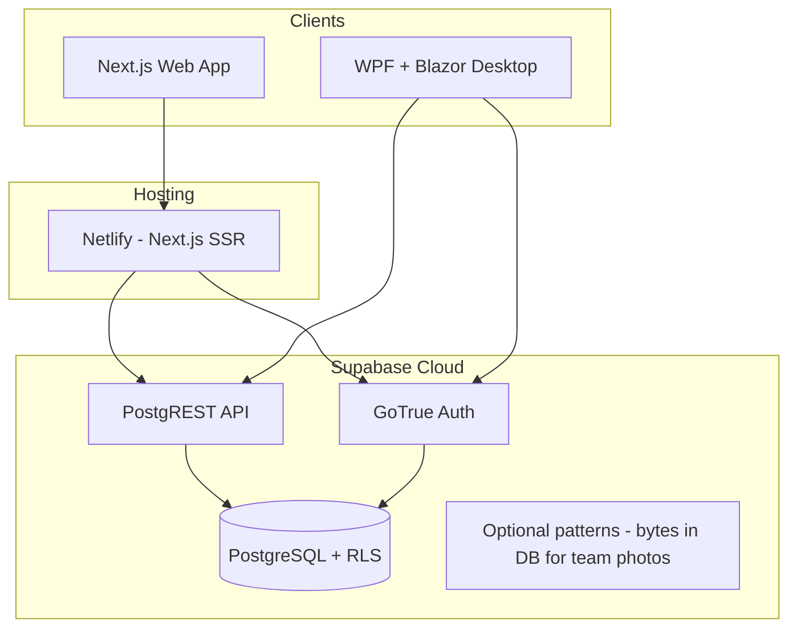
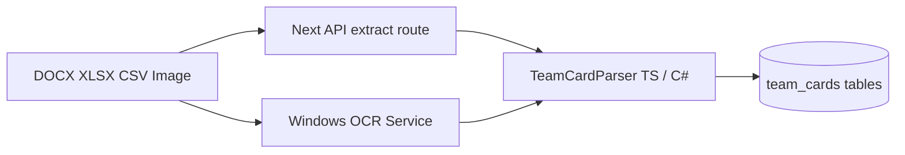

# NSBM Recreation Center Manager — Full System Overview

> **Audience:** Third-party reviewers, collaborators, and technical stakeholders.  
> **Scope:** Architecture of the web app, Supabase backend, and native Windows desktop.

This document describes a **rewamp** of recreation-center operations: one **Supabase** backend, **two clients** (browser and native Windows), and shared domain logic for students, achievements, records, inventory, certificates, and team cards.

Architecture notes below align with the project knowledge graph (`graphify-out/`, commit `8ab9f9ba`): ~223 files, 1,855 nodes, 3,525 edges, 109 communities, no import cycles.

---

## 1. High-level architecture

**Design principle:** All authoritative data lives in **Postgres**. Clients never hold a separate database; they differ only in **UI host**, **session storage**, and **local OS integration** (OCR, window chrome, DPAPI).

---

## 2. Web application (Node / Next.js)

### Frontend

| Layer | Technology | Role |
|--------|------------|------|
| Framework | **Next.js 16** (App Router) | Routes, SSR/RSC, layouts |
| UI | **React 19**, **TypeScript** | Interactive staff UI |
| Styling | **Tailwind CSS 4** | Layout, dark/light theme |
| Structure | `app/(auth)`, `app/(protected)`, `components/*` | Login vs staff areas |

**User-facing modules:**

- **Students** — faculty/batch navigation, house assignment, search, dialogs, NSBM Foundation CSV/XLSX import
- **Achievements** — two sections (`sports-fiesta`, `inter-university`) via `lib/achievement-sections.ts`; tabs for team achievements vs athletic records
- **Inventory** — categories/phases, CRUD
- **Team cards** — upload Word/Excel/CSV/images, edit rosters, attach reference photos
- **Dashboard / import** — aggregates and bulk import entry
- **Shared UX** — `AppNav`, theme provider, CSV import dialog, sports manager, offline `ConnectionWatch`, login sports transition

Pages are mostly **server components** that load data; heavy interaction lives in **client components** (`*-client.tsx`).

### “Backend” inside the web app (no separate Node API server)

The web app’s server side is **Next.js itself**:

| Mechanism | Location | Purpose |
|-----------|----------|---------|
| **Middleware** | `middleware.ts` → `updateSession()` | Cookie-based Supabase session; redirect unauthenticated users to `/login` |
| **Server Actions** | `app/actions/*.ts` | Mutations: students, records, achievements, inventory, sports/tracks, imports, certificates, team cards |
| **Route handlers** | `app/auth/callback`, `app/api/team-cards/*` | Auth callback; team-card extraction (Node runtime, file parsing/OCR) |
| **Supabase clients** | `lib/supabase/server.ts`, `client.ts`, `middleware.ts` | SSR cookie client vs browser client |
| **Domain libs** | `lib/*` | CSV, faculties, houses, sports catalog, certificates, team-card parsers, pagination (`fetch-all`) |

**Auth & authorization on web:**

- Session: **Supabase Auth** (email/password, invite-only).
- **Role:** JWT `app_metadata.role` — `super` can mutate; others read-only (`getStaffRole()`, `requireSuper()` in `lib/supabase/auth.ts`).
- **RLS** on Postgres enforces the same rules at the database layer (migrations from open authenticated write → super-only policies).

**Data flow (typical write):**  
Browser form → Server Action → `requireSuper()` → Supabase server client → PostgREST → Postgres (RLS) → `revalidatePath()` → UI refresh.

---

## 3. Backend (Supabase)

### Stack

- **PostgreSQL** — schema + business rules
- **PostgREST** — auto REST over tables/views
- **GoTrue** — staff authentication
- **RLS** — row-level security on all staff tables

### Schema evolution (rewamp beyond initial MVP)

Started from `20250531000000_initial_schema.sql` (houses, students, sport_tracks, sport_records, inventory). Later migrations add:

- Extended **student** columns (NSBM intake, faculty, nullable IDs, etc.)
- **Sports achievements** + winners (Fiesta)
- **Inter-university** parallel tables
- **Staff roles** (super vs viewer) and tightened write policies
- **Sports catalog** (`sports` table) shared by UI and imports
- **Certificate references**
- **Achievement years** RPCs
- **Inventory phases**
- **Team cards** — `team_cards`, `team_card_members`, `team_card_photos` (BYTEA, type/size limits, photo count triggers)

### API surface

- **Web:** official `@supabase/supabase-js` + `@supabase/ssr`.
- **Desktop:** custom **`PostgrestClient`** + **`PgQuery`** fluent builder in `RecCenter.Core` (same REST semantics, no Supabase C# SDK dependency).

Core abstractions in the dependency graph include: `createClient()`, `PostgrestClient`, `requireSuper()`, `PgQuery`, `TeamCardParser`.

---

## 4. Native desktop application (.NET / WPF / Blazor)

### Stack

| Layer | Technology |
|--------|------------|
| Shell | **WPF** (.NET 10, `net10.0-windows`) |
| UI | **Blazor** inside **WebView2** (`BlazorWebView`) |
| Styles | **Tailwind** (compiled CSS embedded in exe) |
| Core | **`RecCenter.Core`** — domain + services + Supabase HTTP |
| Host app | **`RecCenter.Desktop`** — window, DI, Razor pages/components |

### Startup & dependency injection

`App.xaml.cs` builds a **ServiceCollection**: `HttpClient`, `AuthService`, `PostgrestClient`, domain services (`StudentsService`, `RecordsService`, `AchievementsService`, `InventoryService`, `ImportService`, `TeamCardsService`, `CertificateService`, …), `WindowsOcrService`, `AppState`, `ConnectionState`, DPAPI-backed `ProtectedSessionStore`.

### Desktop-specific engineering

- **Custom chrome** — `MainWindow`: title bar, minimize/maximize/close, Snap Layouts, maximize above taskbar, multi-monitor/DPI (Win32 interop).
- **Session** — GoTrue password grant + refresh; role exposed as `AuthService.CanEdit` (`super`).
- **Offline** — `ConnectionState` + `OfflineNotice` on login and main layout (parity with web).
- **Team cards** — `TeamCardParser` (DOCX/XLSX/CSV/image + OCR passes) mirrored conceptually with web `lib/team-cards/*` and `app/api/team-cards/extract`.
- **Publish** — self-contained single-file exe (~70 MB), WebView2 runtime on target machines.

### UI parity

Razor counterparts to web features: `Students.razor`, `Achievements.razor`, `Inventory.razor`, `TeamCards.razor`, `Dashboard.razor`, shared dialogs (`CsvImportDialog`, `SportsManager`, `RecordsSection`, etc.). Legacy routes redirected (`LegacyRedirects.razor`: `/import`, `/records`).

---

## 5. Cross-cutting systems

### Bulk import

- **Web:** `app/actions/import.ts` — students (merge/fill/keep logic), records, achievements, inventory; batching via `IMPORT_BATCH_SIZE`; sports resolved through `ensureImportedSports`.
- **Desktop:** `ImportService.cs` + `CsvParser` / workbook helpers in Core — same CSV contracts as the project README.

### Team card ingestion pipeline

Privacy: team-card schema intentionally avoids storing NIC/batch/degree on card entities (see migration comments in `supabase/migrations/`).

### Achievements model

Single routing concept, **two physical table families** — configured in `ACHIEVEMENT_SECTIONS` (Fiesta vs Inter-University), shared UI patterns, separate RPCs for years.

### Theming & resilience

- Web: `ThemeProvider`, `theme-script`, network helpers (`isNetworkError`, offline banners).
- Desktop: `WindowThemeBridge`, `ThemeToggle`, system dark preference.

---

## 6. Deployment & configuration

| Target | Stack |
|--------|--------|
| **Production web** | **Netlify** + `@netlify/plugin-nextjs`, `npm ci && npm run build` |
| **Env** | `NEXT_PUBLIC_SUPABASE_URL`, `NEXT_PUBLIC_SUPABASE_PUBLISHABLE_KEY` |
| **Auth URLs** | Site URL + `/auth/callback` on Netlify domain |
| **Desktop config** | `appsettings.json` (embedded/overridden) — URL + publishable key only |
| **Migrations** | Applied in Supabase SQL editor / migration workflow (`supabase/migrations/`) |

---

## 7. How the rewamp reads as a story

1. **Before:** Spreadsheet-led ops, disconnected formats.
2. **Core platform:** Supabase Postgres + staff auth + RLS as the system of record.
3. **Web rewamp:** Next.js staff portal with imports, dual achievement programs, certificates, team cards, role-gated edits.
4. **Desktop rewamp:** Native Windows app for the same API — better windowing, offline messaging, OCR, encrypted session, single exe distribution.
5. **Distribution:** Netlify for the website; the WPF app for the Windows install.
6. **Maintainability:** Shared domain rules (houses, faculties, sections, sports catalog); dependency graph shows **no import cycles** and clear hubs (`requireSuper`, PostgREST clients, parsers).

---

## 8. Tech stack cheat sheet

**Web:** Next.js 16 · React 19 · TypeScript · Tailwind 4 · Server Actions · Supabase JS/SSR · Papa Parse · fflate (archives) · Netlify

**Backend:** Supabase (Postgres, Auth, RLS, PostgREST) · SQL migrations

**Desktop:** .NET 10 · WPF · Blazor WebView2 · HttpClient + custom PostgREST · Windows OCR · DPAPI session · Tailwind-built CSS

**Packaging:** Inno Setup script in `desktop/installer` for the Windows app

---

## Related project documentation

- [README.md](../README.md) — quick start, CSV formats, deploy notes
- [SETUP.md](../SETUP.md) — Supabase and Netlify setup status
- [desktop/README.md](../desktop/README.md) — Windows desktop build and run
