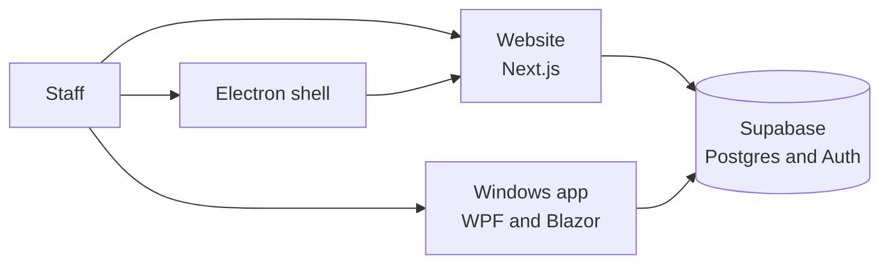
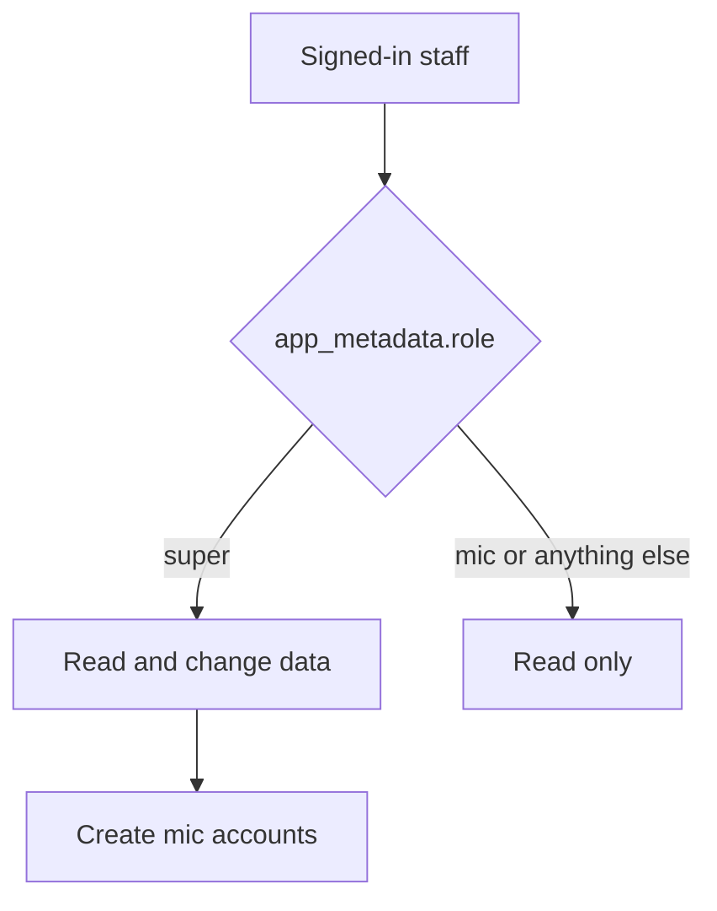
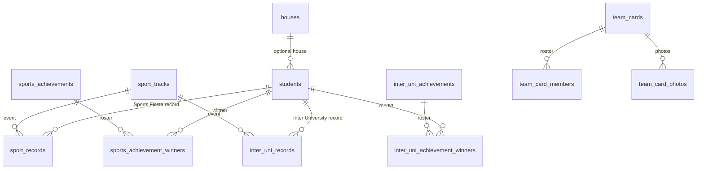

# NSBM Recreation Center

Staff portal for the NSBM Green University recreation center. The website and the Windows app use the same Supabase project, so a change in one shows up in the other.

Signed-in staff can view data. Only an account whose JWT `app_metadata.role` is `super` can add, edit, or delete. Accounts created from the dashboard are given the role `mic` and stay read-only.



The Electron shell only opens the website. The Windows app is a separate program and calls Supabase itself.

## Sections

| Section | What it stores |
| --- | --- |
| Dashboard | Counts of students, this year's athletic records, and inventory items. A super user can add a `mic` account. |
| Students | Students by faculty and batch. Search covers every faculty and batch. House is optional. |
| Achievements | Sports Fiesta and Inter University. Each has sports achievements and athletic records. |
| Team Cards | Rosters for those two sections, with reference photos. |
| Inventory | Equipment counts, split into Phase 01 and Phase 02, and into Rec Inventory and Gym Inventory. |

Faculties are Computing (`FOC`), Business (`FOB`), Engineering (`FOE`), and Sciences (`FOS`). `FOSM` is treated as `FOS`. Houses are Ruby, Citrine, Emerald, and Sapphire.

Sports Fiesta achievements are either other sports or Athletics. Other-sport types are Champion Team, 1st Place, 2nd Place, 3rd Place, and Best Player. Athletics types are 1st Place, 2nd Place, and 3rd Place. Inter University has no category split. A super user can add or delete sports and athletic events from **Add sport**.

A super user can attach certificate files to achievements and records. Team cards accept `.docx`, `.xlsx`, `.csv`, and images. Photos are stored on the card (up to 10, each at most 4 MB). NIC, batch, and degree are not stored on a team card.

Student **Add data** accepts `.xlsx` or `.csv`. The typed batch name is stored as the intake. A workbook is split by faculty: a faculty sheet wins, and blank cells are filled from sheets such as All. Importing again fills only empty fields. **Customize** renames that batch name across every faculty and stops if the new name already exists.

Achievements can be imported from CSV. The `/import` and `/records` addresses redirect into Students and Sports Fiesta records.

If the website or the Windows app cannot reach Supabase, it shows a reconnect reminder. A wrong password still shows the sign-in error. Existing rows are not changed by a failed request.

## Access



Row Level Security allows any signed-in user to read. Insert, update, and delete require `app_metadata.role = super`.

## Data



`sports` is the catalog of other sports and athletic events. `inventory_items` holds name, quantity, phase, and category. Certificate rows are `certificate_references` and `issued_certificates`. Schema changes are the SQL files in `supabase/migrations`, applied in filename order.

## Website

Next.js 16 (App Router), React 19, and Tailwind CSS 4. The app reads `NEXT_PUBLIC_SUPABASE_URL` and `NEXT_PUBLIC_SUPABASE_PUBLISHABLE_KEY`. Do not put the service role key in the website.

```bash
npm install
npm run dev
```

Open http://localhost:3000. Copy `.env.example` to `.env.local` and fill in the two Supabase values. The example file points at project `gykusyazjmfjbdwwinab`.

The deployed site in this repo's config is https://nsbm-recreation-center.netlify.app. Netlify build settings are in `netlify.toml`. Deployment notes are in [DEPLOY-NETLIFY.md](DEPLOY-NETLIFY.md). Supabase setup notes are in [SETUP.md](SETUP.md).

## Windows app

`desktop/` is a WPF window hosting Blazor on WebView2. It targets `net10.0-windows10.0.19041.0` and Windows 10 version 1809 or later. Release publishes a self-contained 64-bit exe, so the other PC does not need a separate .NET install. It does need the WebView2 runtime, which is already on Windows 11.

From `desktop`, after copying `RecCenter.Desktop/appsettings.example.json` to `RecCenter.Desktop/appsettings.json`:

```powershell
dotnet run --project RecCenter.Desktop
dotnet publish RecCenter.Desktop -c Release -r win-x64 --self-contained true -p:PublishSingleFile=true -o publish
```

`appsettings.json` is gitignored. It is embedded at build time. A file with the same name next to the exe overrides it. Use the publishable key only.

`desktop/installer/NSBM-Recreation-Center.iss` builds `NSBM Recreation Center Setup.exe`. The setup includes the published exe and installs the Visual C++ runtime and the WebView2 runtime when they are missing. Those two installers must be placed in `desktop/installer/redist/` before compiling the script. More window and path detail is in [desktop/README.md](desktop/README.md).

## Electron shell

`electron/main.cjs` is an optional window around the website. It loads `ELECTRON_START_URL` or, if that is unset, https://nsbm-recreation-center.netlify.app.

```bash
npm run electron:dev
npm run electron:dist
```

Installers from `electron-builder` are written to `dist-electron/`. This shell is not the WPF app.

## Layout

```
app/                  Website routes: login, dashboard, students, achievements, team cards, inventory
components/           Website UI
lib/                  Shared website logic, including Supabase clients
supabase/migrations/  Postgres schema
supabase/functions/   create-staff-user
electron/             Website shell
desktop/              RecCenter.Core and the WPF app
public/samples/       Example CSV files
```
